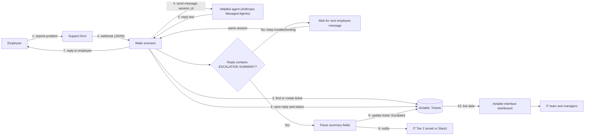
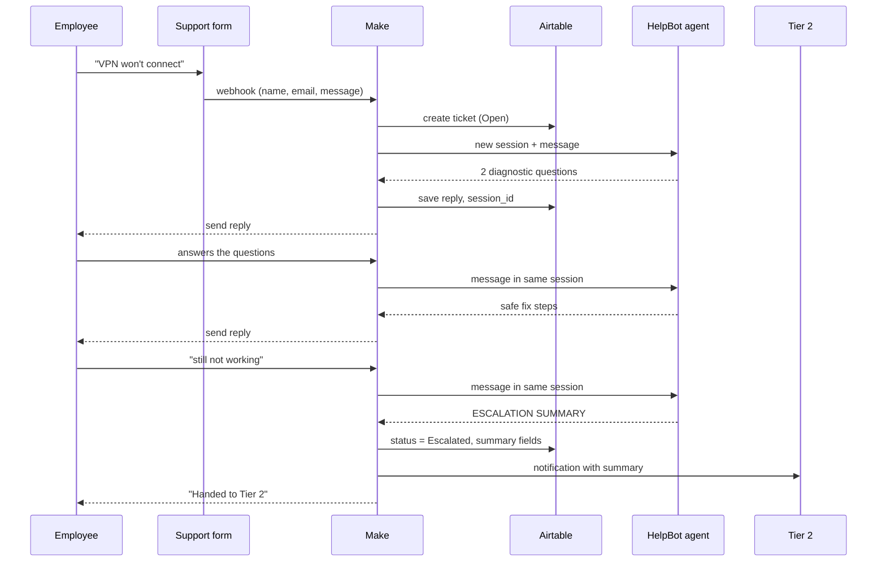

# Architecture: HelpBot AI

This document answers three questions about the agent: **what triggers it**, **where its data comes from and goes to**, and **what we do with its output**.

> **Status:** the agent itself is built and runs on Anthropic Managed Agents (Claude Console). The trigger, database and dashboard below are the **planned design**, not yet built.

## 1. Overview

An employee reports an IT problem. A **Make** scenario receives the report, starts a session with the HelpBot agent on **Anthropic**, and sends the agent's reply back to the employee. Every conversation is logged in an **Airtable** database. When the agent cannot solve the problem, it produces an `ESCALATION SUMMARY`, which Make turns into a Tier 2 ticket and notification. An **Airtable Interface** dashboard shows the IT team what is happening.

## 2. Trigger: what makes the agent run

| Trigger | Description | Chosen |
|---|---|---|
| **Webhook from a support form** | The employee fills a short form (name, description, optional screenshot). The form sends the data to a Make **Custom webhook**. | **Yes (main)** |
| Incoming email | Make "Watch emails" on a shared helpdesk mailbox. | Optional later |
| Chat message (Slack/Teams) | Each message in a support channel starts or continues a session. | Optional later |

Follow-up messages from the same employee (the agent asks 1-2 questions at a time) continue the **same session**, so the agent keeps the context. The `session_id` is stored in Airtable and looked up on every new message.

## 3. Data flow diagram

### Step by step

1. The employee describes the problem in the support form.
2. The form posts JSON to the Make webhook: `employee_name`, `employee_email`, `message`, `timestamp`.
3. Make searches the **Tickets** table for an open ticket by this employee. If none exists, it creates one with status `Open`.
4. Make calls the Anthropic API. For a new ticket it starts a new session; otherwise it sends the message to the stored `session_id`.
5. The agent answers according to its system prompt (acknowledge, clarify, propose safe fixes, escalate).
6. Make saves the reply and the updated status in Airtable.
7. Make sends the reply to the employee (email or chat).
8. A router checks whether the reply contains the `ESCALATION SUMMARY` block. If yes, Make parses the fields (category, priority, impact, steps tried) into Airtable columns and sets the status to `Escalated`.
9. Make notifies Tier 2 with the summary. Security incidents (priority `Security`) are sent to the IT Security channel.
10. The dashboard reads the Tickets table directly.

## 4. Sequence of one conversation

## 5. Database (Airtable)

**Table: Tickets**

| Field | Type | Source |
|---|---|---|
| Ticket ID | Auto number | Airtable |
| Employee name | Text | Form |
| Employee email | Email | Form |
| Created at | Date/time | Form |
| Session ID | Text | Anthropic API |
| Category | Single select: Network/VPN, Software/OS, Hardware, Access | Agent summary, or set to `Unclassified` until known |
| Priority | Single select: Low, Medium, High, Security | Agent summary |
| Status | Single select: Open, Resolved by agent, Escalated, Closed | Make |
| Last reply | Long text | Agent |
| Escalation summary | Long text | Agent (full block) |
| Steps tried | Long text | Agent summary |
| Resolved at | Date/time | Make, when the employee confirms the fix |

**Table: Messages** (optional): one row per message (ticket link, role, text, timestamp) for a full conversation log.

## 6. What we do with the output

| Agent output | Action | Destination |
|---|---|---|
| Normal reply | Send to the employee, store as `Last reply` | Employee, Airtable |
| `ESCALATION SUMMARY` | Parse into fields, set status `Escalated` | Airtable, Tier 2 notification |
| Priority `Security` | Notify IT Security immediately | Security channel |
| Employee confirms "fixed" | Set status `Resolved by agent` | Airtable |
| Agent or API error | Log the error, send the employee a fallback message pointing to the service desk | Make error handler, Employee |

## 7. Dashboard (Airtable Interface)

Shown to the IT team and managers:

- Open tickets now, by category
- Resolved by agent vs escalated (resolution rate)
- Average time to resolution
- Escalations waiting for Tier 2, sorted by priority
- Security incidents list
- Most common issue categories this week

## 8. Components

| Component | Tool | Role |
|---|---|---|
| Agent | Anthropic Managed Agents (Claude Console) | Runs the troubleshooting conversation |
| Orchestration | Make | Receives the trigger, calls the agent, routes the output |
| Database | Airtable | Stores tickets, sessions and escalations |
| Dashboard | Airtable Interface | Live view for IT |
| Notifications | Email or Slack (via Make) | Tier 2 and Security alerts |
| Source and docs | GitHub | Spec, system prompt, this document |

## 9. Security and privacy

- The agent never asks for passwords or MFA codes (rule in the system prompt). Make should also check incoming messages and mask anything that looks like a password or card number before saving it.
- The Anthropic API key and Airtable token are stored in Make connections, never in the repo.
- The repository is public, so it contains only the design and prompt, no real employee data.
- Airtable access is limited to the IT team.

## 10. Cost and limits

- One test session in the Console cost about **$0.02**.
- Each follow-up message adds input and output tokens, so cost grows with conversation length. A monthly spend limit should be set in the Console.
- Make is billed per operation. Each message costs several operations (webhook, lookup, API call, save, send).

## 11. Next steps

1. Replace the agent's system prompt with the full version from the spec and test it.
2. Build the Airtable base (Tickets table).
3. Build the Make scenario: webhook, Airtable lookup, Anthropic call, router, notification.
4. Build the dashboard.
5. Test three scenarios end to end: VPN, printer, security incident.
